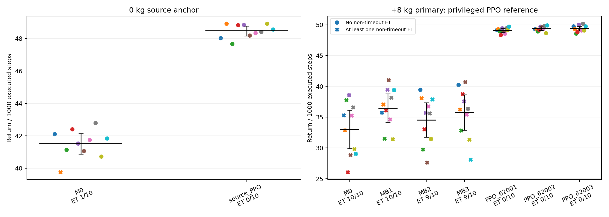

# +8kg privileged PPO target capability comparison

Fresh +8 kg tests give the three privileged target PPOs a mean-of-model-means Return of 49.293074 (between-training-seed SD 0.166054); MB1–3 have 35.580954 (between-adaptation-checkpoint SD 0.970442). The descriptive PPO-minus-MB average difference is +13.712119 per 1000 executed steps. All three policies satisfied the predeclared operational validation plateau and additional-training rule. This supports an observed target-domain performance comparison within the measured support, not optimality or a frozen-R/V causal claim.

PPO A: source actor+critic+optimizer warm-start,433 privileged dimensions. This is an attainable reference, not an optimum or frozen-R/V attribution. PPO begins control immediately; MPPI retains25 zero-action steps. Historical23501–23505 are separate from fresh61001–61010.

| condition | controller/model | mean Return | SD | descriptive t95 interval | ET seeds/10 | ET events | vx RMSE |
|---|---|---:|---:|---|---:|---:|---:|
| mass8 | M0 | 33.010874 | 4.335687 | [29.909310,36.112438] | 10/10 | 28 | 0.215741 |
| mass8 | MB1 | 36.450953 | 3.263829 | [34.116151,38.785755] | 10/10 | 24 | 0.199033 |
| mass8 | MB2 | 34.534330 | 3.910354 | [31.737032,37.331629] | 9/10 | 28 | 0.203417 |
| mass8 | MB3 | 35.757580 | 4.003729 | [32.893485,38.621675] | 9/10 | 23 | 0.195686 |
| mass8 | PPO_62001 | 49.101395 | 0.422814 | [48.798932,49.403859] | 0/10 | 0 | 0.090997 |
| mass8 | PPO_62002 | 49.384606 | 0.399027 | [49.099160,49.670053] | 0/10 | 0 | 0.091822 |
| mass8 | PPO_62003 | 49.393219 | 0.523632 | [49.018635,49.767802] | 0/10 | 0 | 0.088230 |
| mass0 | M0 | 41.512882 | 0.883370 | [40.880957,42.144807] | 1/10 | 2 | 0.136317 |
| mass0 | source_PPO | 48.467438 | 0.425418 | [48.163113,48.771764] | 0/10 | 0 | 0.097439 |

## Source, physics and interface contracts

Scientific protocol commit `5e5fb7be76fe05bc56684e11c4aae605fd4db852`, SHA256 `a183dabd0f40812bcd16936c8011b7aea4f0a8a2163f7beb8933ff78595bf37d`. Original source HEAD `dddd601f746477bce89e00be729eebb4e7c21a2a`; pre-existing MPPI/trainer dirty diff is retained, not silently reset. New-root code is committed separately and hashed in09_provenance. Current versions: IsaacSim4.5.0.0, IsaacLab source VERSION2.0.1 (installed metadata0.33.17), Python3.10.21, Torch2.5.1+cu121/CUDA build12.1, RSL-RL2.2.1, RTX4070SUPER12282MiB, NVIDIA driver580.178.04. Historical version equivalence is not established.

Runtime target base mass6.921000480651855→14.921000480651855kg; default other-body masses remain unchanged and inertia scales with the additive mass ratio. Every initial/reset readback checks Kp25/Kd0.5, four-foot static/dynamic friction0.8000000119/restitution0.05000000075, effort limit23.5 and velocity limit30. Control dt0.02, physics dt0.005; boxes terrain difficulty0.4. WalkStraightCommand advances the0.5m/s reference trajectory and uses position/heading feedback, so its instantaneous command can differ from(0.5,0,0). Initial/reset command fields and terrain/full root+joint-state hashes are retained. Background joint-friction Uniform(0,0.05) additive reset remains canonical; source gain/material/base-pose/push/curriculum randomization is fixed or removed as specified in effective configs.

Both controllers emit12 raw joint-position-action coordinates in source joint order FR/FL/RR/RL hip/thigh/calf; physical target=default joint position+0.25×raw action, configured clip None. PPO actor/critic are433→512ELU→512ELU→512ELU→12/1 with Identity normalizers. Privileged fields add24 foot-wrench,4 foot-height,1 mass,3 material,12 stiffness,12 damping,12 joint-friction dimensions to365 other dimensions. SimDist inputs are35 proprioception,315 terrain scan,3 command,12 action coordinates over historyH25; latent64. MPPI uses horizonT25,450 noise+22 mixture candidates,8 iterations,64 elites, discount0.99; its predicted score is distinct from actual accumulated evaluation reward. It executes25 zero actions after every reset while the environment reward still uses its feedback command. PPO acts immediately; this startup/controller/information difference prevents an observation-matched or isolated-value causal interpretation.

| checkpoint | source/model step | SHA256 bundle or file |
|---|---:|---|
| M0 | 367004 | `5f079929f9829d60f3fb90d46196e85a3f7fd3790292473a6baf12a05f7d8727` |
| MB1 | 368004 | `399eaf575a92c72248100cf20353c6093a6cfbf0c26929ac157fbb9c25d66be6` |
| MB2 | 368004 | `54310095e54942468cfc3984194e75f25f07e68f79f3d3b48131b4d369b2366a` |
| MB3 | 368004 | `0f3f989170a8c43129dcc5e59fa7676a169c7cb035c8c3f35a0a51bc6722373d` |
| released source PPO | retained iter4999; original source env-step provenance unavailable | `48cf4e95ef853d2addc5c3a5b2e2eab675dfc5d0b89d5ca33efc6aa102857d7a` |

Per-file hash inventory and bundle definition are in CHECKPOINT_HASHES.json. CPU checkpoint-state comparison confirms each MB changes52 learned dynamics leaves plus1 RNG counter and0 leaves outside dynamics; MB f-onlyK1000/batch32 provenance is reused unchanged. Source checkpoints and402 audited code/config/raw files are rehashed against the prior audit. Target PPO counters count only added target training, not source iter4999 or excluded smoke transitions. Training4096×24×5000=491520000 is the source recipe reference milestone from [paper Appendix C](https://arxiv.org/html/2603.15759v1), not a target convergence proof or compulsory stopping iteration.

Reward definitions are exactly the retained canonical dictionaries and applied on the same control dt. PPO step term contributions are raw manager reward densities×0.02; their sum is checked against actual recorded reward. Evaluation Return uniformly sums float32 recorded samples in float64. Non-timeout terminated is ET; timeout and budget censoring are separate, all runs fill1000 executed steps. Training RSL timeout bootstrap is disclosed separately from raw evaluation reward. Tracking RMSE uses actual pre-action body forward vx against reference0.5 across all1000 steps, including MPPI warmup. The t95 intervals condition on a fixed model and ten evaluation seeds. Torque clipping fraction uses post-step computed-versus-applied torque differences (>1e-6) on joint/control-step cells; reset-step trace semantics are shared.

## All raw per-evaluation-seed rows

| condition | model | eval seed | Return | ET0/1 | ET events | vx RMSE | steps |
|---|---|---:|---:|---:|---:|---:|---:|
| mass8 | M0 | 61001 | 35.286402186 | 1 | 2 | 0.190410 | 1000 |
| mass8 | M0 | 61002 | 32.886750654 | 1 | 4 | 0.233211 | 1000 |
| mass8 | M0 | 61003 | 37.769972386 | 1 | 1 | 0.153593 | 1000 |
| mass8 | M0 | 61004 | 26.054041273 | 1 | 6 | 0.306132 | 1000 |
| mass8 | M0 | 61005 | 38.603214057 | 1 | 1 | 0.148400 | 1000 |
| mass8 | M0 | 61006 | 28.820895068 | 1 | 3 | 0.242519 | 1000 |
| mass8 | M0 | 61007 | 35.255495721 | 1 | 1 | 0.150146 | 1000 |
| mass8 | M0 | 61008 | 36.602774153 | 1 | 2 | 0.210993 | 1000 |
| mass8 | M0 | 61009 | 29.806418978 | 1 | 5 | 0.278462 | 1000 |
| mass8 | M0 | 61010 | 29.022779532 | 1 | 3 | 0.243549 | 1000 |
| mass8 | MB1 | 61001 | 35.752228580 | 1 | 2 | 0.187360 | 1000 |
| mass8 | MB1 | 61002 | 37.051444591 | 1 | 3 | 0.205725 | 1000 |
| mass8 | MB1 | 61003 | 31.495455977 | 1 | 4 | 0.241628 | 1000 |
| mass8 | MB1 | 61004 | 36.101166732 | 1 | 3 | 0.214592 | 1000 |
| mass8 | MB1 | 61005 | 39.457154846 | 1 | 1 | 0.150799 | 1000 |
| mass8 | MB1 | 61006 | 41.024446261 | 1 | 1 | 0.151134 | 1000 |
| mass8 | MB1 | 61007 | 34.640554635 | 1 | 2 | 0.213079 | 1000 |
| mass8 | MB1 | 61008 | 38.170620263 | 1 | 2 | 0.184939 | 1000 |
| mass8 | MB1 | 61009 | 31.409376321 | 1 | 5 | 0.286148 | 1000 |
| mass8 | MB1 | 61010 | 39.407082600 | 1 | 1 | 0.154923 | 1000 |
| mass8 | MB2 | 61001 | 39.471243336 | 0 | 0 | 0.129469 | 1000 |
| mass8 | MB2 | 61002 | 38.076398198 | 1 | 1 | 0.151562 | 1000 |
| mass8 | MB2 | 61003 | 29.744974697 | 1 | 6 | 0.264401 | 1000 |
| mass8 | MB2 | 61004 | 33.014529663 | 1 | 5 | 0.243914 | 1000 |
| mass8 | MB2 | 61005 | 35.675792805 | 1 | 3 | 0.202960 | 1000 |
| mass8 | MB2 | 61006 | 27.639845269 | 1 | 3 | 0.272926 | 1000 |
| mass8 | MB2 | 61007 | 36.738335822 | 1 | 1 | 0.153133 | 1000 |
| mass8 | MB2 | 61008 | 35.618977266 | 1 | 3 | 0.203651 | 1000 |
| mass8 | MB2 | 61009 | 31.477200140 | 1 | 5 | 0.256016 | 1000 |
| mass8 | MB2 | 61010 | 37.886005468 | 1 | 1 | 0.156137 | 1000 |
| mass8 | MB3 | 61001 | 40.239246645 | 0 | 0 | 0.130110 | 1000 |
| mass8 | MB3 | 61002 | 36.254338660 | 1 | 3 | 0.203731 | 1000 |
| mass8 | MB3 | 61003 | 32.822413751 | 1 | 3 | 0.222752 | 1000 |
| mass8 | MB3 | 61004 | 38.743285588 | 1 | 1 | 0.153357 | 1000 |
| mass8 | MB3 | 61005 | 37.573082641 | 1 | 1 | 0.150117 | 1000 |
| mass8 | MB3 | 61006 | 40.717259796 | 1 | 1 | 0.147055 | 1000 |
| mass8 | MB3 | 61007 | 35.414901272 | 1 | 2 | 0.189042 | 1000 |
| mass8 | MB3 | 61008 | 36.355098067 | 1 | 3 | 0.200639 | 1000 |
| mass8 | MB3 | 61009 | 31.360311734 | 1 | 5 | 0.263905 | 1000 |
| mass8 | MB3 | 61010 | 28.095859568 | 1 | 4 | 0.296151 | 1000 |
| mass8 | PPO_62001 | 61001 | 49.175645271 | 0 | 0 | 0.090536 | 1000 |
| mass8 | PPO_62001 | 61002 | 49.296842974 | 0 | 0 | 0.091245 | 1000 |
| mass8 | PPO_62001 | 61003 | 48.981314671 | 0 | 0 | 0.091865 | 1000 |
| mass8 | PPO_62001 | 61004 | 48.359209137 | 0 | 0 | 0.092541 | 1000 |
| mass8 | PPO_62001 | 61005 | 49.438736387 | 0 | 0 | 0.090538 | 1000 |
| mass8 | PPO_62001 | 61006 | 48.904042241 | 0 | 0 | 0.091880 | 1000 |
| mass8 | PPO_62001 | 61007 | 48.540920856 | 0 | 0 | 0.090767 | 1000 |
| mass8 | PPO_62001 | 61008 | 49.456025478 | 0 | 0 | 0.087943 | 1000 |
| mass8 | PPO_62001 | 61009 | 49.121926961 | 0 | 0 | 0.091887 | 1000 |
| mass8 | PPO_62001 | 61010 | 49.739290931 | 0 | 0 | 0.090770 | 1000 |
| mass8 | PPO_62002 | 61001 | 49.308093550 | 0 | 0 | 0.091558 | 1000 |
| mass8 | PPO_62002 | 61002 | 49.248877974 | 0 | 0 | 0.090138 | 1000 |
| mass8 | PPO_62002 | 61003 | 48.930007999 | 0 | 0 | 0.092665 | 1000 |
| mass8 | PPO_62002 | 61004 | 49.210499155 | 0 | 0 | 0.093257 | 1000 |
| mass8 | PPO_62002 | 61005 | 49.726141203 | 0 | 0 | 0.091129 | 1000 |
| mass8 | PPO_62002 | 61006 | 49.615645722 | 0 | 0 | 0.091981 | 1000 |
| mass8 | PPO_62002 | 61007 | 49.375219688 | 0 | 0 | 0.091859 | 1000 |
| mass8 | PPO_62002 | 61008 | 49.824179678 | 0 | 0 | 0.089159 | 1000 |
| mass8 | PPO_62002 | 61009 | 48.673094497 | 0 | 0 | 0.094448 | 1000 |
| mass8 | PPO_62002 | 61010 | 49.934304436 | 0 | 0 | 0.092025 | 1000 |
| mass8 | PPO_62003 | 61001 | 49.750618291 | 0 | 0 | 0.088644 | 1000 |
| mass8 | PPO_62003 | 61002 | 49.326709512 | 0 | 0 | 0.087607 | 1000 |
| mass8 | PPO_62003 | 61003 | 48.584172890 | 0 | 0 | 0.089444 | 1000 |
| mass8 | PPO_62003 | 61004 | 48.816241653 | 0 | 0 | 0.089915 | 1000 |
| mass8 | PPO_62003 | 61005 | 50.030310806 | 0 | 0 | 0.087817 | 1000 |
| mass8 | PPO_62003 | 61006 | 49.256751767 | 0 | 0 | 0.088202 | 1000 |
| mass8 | PPO_62003 | 61007 | 49.111846532 | 0 | 0 | 0.087894 | 1000 |
| mass8 | PPO_62003 | 61008 | 50.189892316 | 0 | 0 | 0.085318 | 1000 |
| mass8 | PPO_62003 | 61009 | 49.111424305 | 0 | 0 | 0.088489 | 1000 |
| mass8 | PPO_62003 | 61010 | 49.754218909 | 0 | 0 | 0.088972 | 1000 |
| mass0 | M0 | 66001 | 42.103921738 | 0 | 0 | 0.122165 | 1000 |
| mass0 | M0 | 66002 | 39.758694905 | 1 | 2 | 0.195344 | 1000 |
| mass0 | M0 | 66003 | 41.147643128 | 0 | 0 | 0.135459 | 1000 |
| mass0 | M0 | 66004 | 42.411986683 | 0 | 0 | 0.120950 | 1000 |
| mass0 | M0 | 66005 | 41.529677951 | 0 | 0 | 0.139158 | 1000 |
| mass0 | M0 | 66006 | 41.060866678 | 0 | 0 | 0.140594 | 1000 |
| mass0 | M0 | 66007 | 41.754896702 | 0 | 0 | 0.122843 | 1000 |
| mass0 | M0 | 66008 | 42.798294879 | 0 | 0 | 0.133648 | 1000 |
| mass0 | M0 | 66009 | 40.719197455 | 0 | 0 | 0.126959 | 1000 |
| mass0 | M0 | 66010 | 41.843638951 | 0 | 0 | 0.126049 | 1000 |
| mass0 | source_PPO | 66001 | 48.017682559 | 0 | 0 | 0.099069 | 1000 |
| mass0 | source_PPO | 66002 | 48.915983289 | 0 | 0 | 0.098382 | 1000 |
| mass0 | source_PPO | 66003 | 47.661553353 | 0 | 0 | 0.099712 | 1000 |
| mass0 | source_PPO | 66004 | 48.833581967 | 0 | 0 | 0.096254 | 1000 |
| mass0 | source_PPO | 66005 | 48.836397068 | 0 | 0 | 0.098124 | 1000 |
| mass0 | source_PPO | 66006 | 48.192923590 | 0 | 0 | 0.097731 | 1000 |
| mass0 | source_PPO | 66007 | 48.334385691 | 0 | 0 | 0.095278 | 1000 |
| mass0 | source_PPO | 66008 | 48.409026259 | 0 | 0 | 0.098281 | 1000 |
| mass0 | source_PPO | 66009 | 48.916048994 | 0 | 0 | 0.096515 | 1000 |
| mass0 | source_PPO | 66010 | 48.556801077 | 0 | 0 | 0.095041 | 1000 |

## Paired differences

| condition | comparison minus reference | mean delta | SD | conditional descriptive t95 |
|---|---|---:|---:|---|
| mass8 | MB1−M0 | +3.440079 | 5.796838 | [-0.706729,7.586886] |
| mass8 | MB2−M0 | +1.523456 | 5.039453 | [-2.081552,5.128463] |
| mass8 | MB3−M0 | +2.746705 | 5.694713 | [-1.327047,6.820458] |
| mass8 | PPO_62001−M0 | +16.090521 | 4.230588 | [13.064141,19.116901] |
| mass8 | PPO_62002−M0 | +16.373732 | 4.316128 | [13.286160,19.461304] |
| mass8 | PPO_62003−M0 | +16.382344 | 4.190270 | [13.384806,19.379883] |
| mass8 | PPO_62001−MB1 | +12.650442 | 3.137681 | [10.405881,14.895004] |
| mass8 | PPO_62002−MB1 | +12.933653 | 2.917345 | [10.846710,15.020596] |
| mass8 | PPO_62003−MB1 | +12.942266 | 2.966132 | [10.820423,15.064108] |
| mass8 | PPO_62001−MB2 | +14.567065 | 3.767732 | [11.871792,17.262338] |
| mass8 | PPO_62002−MB2 | +14.850276 | 3.790967 | [12.138382,17.562170] |
| mass8 | PPO_62003−MB2 | +14.858888 | 3.644744 | [12.251596,17.466181] |
| mass8 | PPO_62001−MB3 | +13.343816 | 4.198213 | [10.340595,16.347037] |
| mass8 | PPO_62002−MB3 | +13.627027 | 3.986024 | [10.775596,16.478457] |
| mass8 | PPO_62003−MB3 | +13.635639 | 3.989485 | [10.781733,16.489544] |
| mass0 | source_PPO−M0 | +6.954556 | 1.060248 | [6.196101,7.713012] |

## Convergence: each independent training seed

Seed62001: 2000 target iterations, 196608000 target transitions, 40000 target Adam updates. Status OPERATIONAL_PLATEAU_CONFIRMED. Candidate iteration1000 confirmed after1000 additional iterations. Paired validation mean change-0.158058, SD0.333973, t95[-0.3969676978472121, 0.08085145333250646]; ET rate change+0.000, vx RMSE change+0.000795. Final validation Return49.083184, SD0.321513, ET rate0.000. Final checkpoint `artifact://privileged_ppo/02_training/seed_62001/checkpoints/target_002000.pt`, SHA256 `0d6d57b86d22712345af1acfd7e6a0086412859756b907cef6aa3e73abf8197d`.

Seed62002: 2000 target iterations, 196608000 target transitions, 40000 target Adam updates. Status OPERATIONAL_PLATEAU_CONFIRMED. Candidate iteration1000 confirmed after1000 additional iterations. Paired validation mean change-0.050712, SD0.287708, t95[-0.25652600576755985, 0.15510205172355684]; ET rate change+0.000, vx RMSE change-0.000134. Final validation Return49.168350, SD0.361896, ET rate0.000. Final checkpoint `artifact://privileged_ppo/02_training/seed_62002/checkpoints/target_002000.pt`, SHA256 `9ec06e1044da70d1b84333275ce59ac3005c72387005e156d4d0cda81a51386f`.

Seed62003: 2000 target iterations, 196608000 target transitions, 40000 target Adam updates. Status OPERATIONAL_PLATEAU_CONFIRMED. Candidate iteration1000 confirmed after1000 additional iterations. Paired validation mean change-0.161615, SD0.233908, t95[-0.3289418777498201, 0.005712877204131189]; ET rate change+0.000, vx RMSE change+0.000257. Final validation Return49.331889, SD0.389665, ET rate0.000. Final checkpoint `artifact://privileged_ppo/02_training/seed_62003/checkpoints/target_002000.pt`, SHA256 `003e76f76c381e686d3f818af7fc2fb66202bb17c043fb53e8b5bda91d3db839`.

### Every validation checkpoint

| training seed | target iterations | target transitions | validation mean Return | eval SD | ET events | ET seed rate | vx RMSE |
|---:|---:|---:|---:|---:|---:|---:|---:|
| 62001 | 0 | 0 | 46.617617 | 0.381334 | 0 | 0.000 | 0.094384 |
| 62001 | 250 | 24576000 | 49.179794 | 0.150874 | 0 | 0.000 | 0.090015 |
| 62001 | 500 | 49152000 | 49.354300 | 0.137394 | 0 | 0.000 | 0.089788 |
| 62001 | 750 | 73728000 | 49.297616 | 0.211696 | 0 | 0.000 | 0.089827 |
| 62001 | 1000 | 98304000 | 49.241242 | 0.370089 | 0 | 0.000 | 0.090712 |
| 62001 | 1250 | 122880000 | 49.207488 | 0.411937 | 0 | 0.000 | 0.091279 |
| 62001 | 1500 | 147456000 | 49.042182 | 0.381868 | 0 | 0.000 | 0.091142 |
| 62001 | 1750 | 172032000 | 49.117856 | 0.280463 | 0 | 0.000 | 0.091302 |
| 62001 | 2000 | 196608000 | 49.083184 | 0.321513 | 0 | 0.000 | 0.091508 |
| 62002 | 0 | 0 | 46.617617 | 0.381334 | 0 | 0.000 | 0.094384 |
| 62002 | 250 | 24576000 | 49.201386 | 0.109652 | 0 | 0.000 | 0.090064 |
| 62002 | 500 | 49152000 | 49.409758 | 0.203681 | 0 | 0.000 | 0.092922 |
| 62002 | 750 | 73728000 | 49.340035 | 0.240423 | 0 | 0.000 | 0.093111 |
| 62002 | 1000 | 98304000 | 49.219062 | 0.293605 | 0 | 0.000 | 0.092700 |
| 62002 | 1250 | 122880000 | 49.232293 | 0.214849 | 0 | 0.000 | 0.092873 |
| 62002 | 1500 | 147456000 | 49.081737 | 0.320174 | 0 | 0.000 | 0.092884 |
| 62002 | 1750 | 172032000 | 49.101042 | 0.406097 | 0 | 0.000 | 0.092767 |
| 62002 | 2000 | 196608000 | 49.168350 | 0.361896 | 0 | 0.000 | 0.092566 |
| 62003 | 0 | 0 | 46.617617 | 0.381334 | 0 | 0.000 | 0.094384 |
| 62003 | 250 | 24576000 | 49.293657 | 0.111464 | 0 | 0.000 | 0.088998 |
| 62003 | 500 | 49152000 | 49.606254 | 0.249609 | 0 | 0.000 | 0.088611 |
| 62003 | 750 | 73728000 | 49.542105 | 0.266667 | 0 | 0.000 | 0.089036 |
| 62003 | 1000 | 98304000 | 49.493503 | 0.279667 | 0 | 0.000 | 0.088887 |
| 62003 | 1250 | 122880000 | 49.271237 | 0.374331 | 0 | 0.000 | 0.088831 |
| 62003 | 1500 | 147456000 | 49.325055 | 0.329556 | 0 | 0.000 | 0.088609 |
| 62003 | 1750 | 172032000 | 49.339943 | 0.294213 | 0 | 0.000 | 0.088760 |
| 62003 | 2000 | 196608000 | 49.331889 | 0.389665 | 0 | 0.000 | 0.089143 |

### Training stability, final 250-iteration window

| training seed | metric | mean | min | max | last |
|---:|---|---:|---:|---:|---:|
| 62001 | value_loss | 6.6517616e-06 | 3.5517074e-06 | 6.1698967e-05 | 6.1604434e-06 |
| 62001 | KL_full_update | 0.0092675898 | 0.0057116969 | 0.017042939 | 0.0086926747 |
| 62001 | mean_action_std | 0.060358271 | 0.059704892 | 0.060723256 | 0.060490392 |
| 62001 | min_action_std | 0.049400458 | 0.048375618 | 0.050271485 | 0.049658265 |
| 62001 | mean_minibatch_differential_entropy | -16.76627 | -16.894932 | -16.691472 | -16.741059 |
| 62002 | value_loss | 7.6515141e-06 | 4.6627186e-06 | 2.5754073e-05 | 5.4652078e-06 |
| 62002 | KL_full_update | 0.0093412609 | 0.005303341 | 0.0173356 | 0.0076165016 |
| 62002 | mean_action_std | 0.067422216 | 0.064388216 | 0.070399195 | 0.064388216 |
| 62002 | min_action_std | 0.053571132 | 0.050276406 | 0.056794375 | 0.050276406 |
| 62002 | mean_minibatch_differential_entropy | -15.458858 | -16.013907 | -14.929154 | -16.013907 |
| 62003 | value_loss | 1.0476677e-05 | 5.4477616e-06 | 7.287901e-05 | 9.6544389e-06 |
| 62003 | KL_full_update | 0.008988968 | 0.0053542779 | 0.016337413 | 0.0069091023 |
| 62003 | mean_action_std | 0.068485666 | 0.067719691 | 0.069209568 | 0.067912899 |
| 62003 | min_action_std | 0.053049272 | 0.051517658 | 0.053984009 | 0.052314341 |
| 62003 | mean_minibatch_differential_entropy | -15.27532 | -15.414102 | -15.145947 | -15.378489 |

Entropy is corrected for the installed source logging accumulator: the raw source sum across 20 mini-batches is divided by 20 for this table. Negative Gaussian differential entropy alone is not failure; action standard deviations and KL are reported alongside it. All recorded weights/actions/rewards and diagnostic values are checked finite. Value loss is not the policy plateau criterion.

### Repeat variance units

| repeat type | repeats | mean of model means | SD of model means | range | descriptive ET cells |
|---|---:|---:|---:|---|---:|
| PPO_training_seeds | 3 | 49.293074 | 0.166054 | [49.101395,49.393219] | 0/30 |
| MB_adaptation_checkpoints | 3 | 35.580954 | 0.970442 | [34.534330,36.450953] | 28/30 |
## Critic support diagnostics

| train seed | target | supported states | bias V−RTG | RMSE | rank correlation |
|---:|---|---:|---:|---:|---:|
| 62001 | complete_non_timeout_MC | 0 | UNAVAILABLE | UNAVAILABLE | UNAVAILABLE |
| 62001 | truncated_500_no_bootstrap_secondary | 5010 | 0.26081358622186723 | 0.28159880858642955 | 0.5178388000422433 |
| 62002 | complete_non_timeout_MC | 0 | UNAVAILABLE | UNAVAILABLE | UNAVAILABLE |
| 62002 | truncated_500_no_bootstrap_secondary | 5010 | 0.2754613627122795 | 0.2956746218968958 | 0.3717292347719932 |
| 62003 | complete_non_timeout_MC | 0 | UNAVAILABLE | UNAVAILABLE | UNAVAILABLE |
| 62003 | truncated_500_no_bootstrap_secondary | 5010 | 0.25474128801744134 | 0.2701986037087998 | 0.519748435786436 |

## Historical corrected S4 consistency, separate provenance

| model | historical eval seed | float32 canonical Return | ET seed | ET events | source config SHA256 |
|---|---:|---:|---:|---:|---|
| M0 | 23501 | 35.685821533 | 1 | 3 | `d902412e32ea457d36b2748515cb98cd5435399236cf4697c52bc32ecc8dd9b1` |
| M0 | 23502 | 39.722854614 | 1 | 1 | `c07e27540ba89b2fa62a908d49e35962f9c3c7ba92a240f28dd2fdd733011fa2` |
| M0 | 23503 | 36.311367035 | 1 | 1 | `fbdc0b041179d1fdcae2aaa526b8e144ab558f6a2b3ceb70aaca65caf93941df` |
| M0 | 23504 | 29.502765656 | 1 | 7 | `fa04cd51a207a9294abb76a39fb81ee44e1d20b89b01ba0eeeafe8c9c05d492f` |
| M0 | 23505 | 40.074790955 | 0 | 0 | `4eab3e42469b28aa643a18c26c7f7eda397bf4a66f7989bcdf2af06bb5639f6b` |
| MB1 | 23501 | 38.925491333 | 1 | 1 | `d902412e32ea457d36b2748515cb98cd5435399236cf4697c52bc32ecc8dd9b1` |
| MB1 | 23502 | 39.730316162 | 1 | 1 | `c07e27540ba89b2fa62a908d49e35962f9c3c7ba92a240f28dd2fdd733011fa2` |
| MB1 | 23503 | 39.704822540 | 1 | 1 | `fbdc0b041179d1fdcae2aaa526b8e144ab558f6a2b3ceb70aaca65caf93941df` |
| MB1 | 23504 | 35.923561096 | 1 | 3 | `fa04cd51a207a9294abb76a39fb81ee44e1d20b89b01ba0eeeafe8c9c05d492f` |
| MB1 | 23505 | 40.236457825 | 0 | 0 | `4eab3e42469b28aa643a18c26c7f7eda397bf4a66f7989bcdf2af06bb5639f6b` |
| MB2 | 23501 | 33.145584106 | 1 | 2 | `d902412e32ea457d36b2748515cb98cd5435399236cf4697c52bc32ecc8dd9b1` |
| MB2 | 23502 | 38.586112976 | 1 | 1 | `c07e27540ba89b2fa62a908d49e35962f9c3c7ba92a240f28dd2fdd733011fa2` |
| MB2 | 23503 | 39.599029541 | 1 | 1 | `fbdc0b041179d1fdcae2aaa526b8e144ab558f6a2b3ceb70aaca65caf93941df` |
| MB2 | 23504 | 37.277580261 | 1 | 1 | `fa04cd51a207a9294abb76a39fb81ee44e1d20b89b01ba0eeeafe8c9c05d492f` |
| MB2 | 23505 | 40.455963135 | 0 | 0 | `4eab3e42469b28aa643a18c26c7f7eda397bf4a66f7989bcdf2af06bb5639f6b` |
| MB3 | 23501 | 31.576988220 | 1 | 7 | `d902412e32ea457d36b2748515cb98cd5435399236cf4697c52bc32ecc8dd9b1` |
| MB3 | 23502 | 38.816490173 | 1 | 1 | `c07e27540ba89b2fa62a908d49e35962f9c3c7ba92a240f28dd2fdd733011fa2` |
| MB3 | 23503 | 39.534236908 | 1 | 1 | `fbdc0b041179d1fdcae2aaa526b8e144ab558f6a2b3ceb70aaca65caf93941df` |
| MB3 | 23504 | 33.158229828 | 1 | 2 | `fa04cd51a207a9294abb76a39fb81ee44e1d20b89b01ba0eeeafe8c9c05d492f` |
| MB3 | 23505 | 36.592437744 | 1 | 2 | `4eab3e42469b28aa643a18c26c7f7eda397bf4a66f7989bcdf2af06bb5639f6b` |

| model | historical mean Return | paired change vs M0 | ET seeds/5 |
|---|---:|---:|---:|
| M0 | 36.259520 | +0.000000 | 4/5 |
| MB1 | 38.904130 | +2.644610 | 4/5 |
| MB2 | 37.812854 | +1.553334 | 4/5 |
| MB3 | 35.935677 | -0.323843 | 5/5 |

Critic rollouts sample the final trained Gaussian policy on separate67001–67010; primary/validation use deterministic actor mean. Critic fit therefore targets the trained stochastic policy, not directly the deterministic primary deployment. Complete terminal Monte Carlo fit uses gamma.99 and stops at non-timeout termination. Timeout/censored segments are excluded from this fit. The separate500-step unbootstrapped diagnostic has a truncated target and must not be called exact full-horizon value accuracy. States from one trajectory are correlated; no global oracle claim. Source RSL timeout bootstrap adds gamma times pre-step critic V on truncated transitions; this is recorded separately from raw evaluation reward.

## Units, provenance and limitations

Within-checkpoint intervals condition on10 evaluation seeds. PPO variation across3 independent target training seeds is reported separately; MB adaptation checkpoints are a distinct repeat type.3×10 is not30 independent trained policies. Raw same-seed deltas live in PAIRED_RETURN_DELTAS.csv. Every step reward/privileged critic input/termination/raw artifact is retained, including checkpoint SHA and full readbacks. Pairing audit marks actual equality of initial states/config/terrain; it does not require later diverging trajectories to share PhysX states.

Frozen new train/validation/test/critic/anchor roles are disjoint and no primary evaluation preceded final policy selection. Historical source PPO/WM original seed records are unavailable; absolute historical-data non-overlap cannot be certified. Privileged actor/critic receive normalized mass delta (8 at target), normalized gains (0 at fixed source-reference gain), foot wrenches/heights, material and joint-friction fields. Full field dimensions and actual value ranges are retained in runtime readbacks. The SimDist latent value input and its controlled policy differ; no critic weight transplant or oracle claim is made.

Historical anchors remain M0=36.259520,MB1=38.904130,MB2=37.812854,MB3=35.935677 with ET4/5,4/5,4/5,5/5. They are not added to the fresh primary sample. Source PPO0kg versus M00kg measures an information/controller/optimization mixture; any difference-of-gaps is descriptive only. No f/V/R intervention, new WM adaptation, T1/T2/T3, or other gap screening occurred.

Seed62001 resumed once from target iteration250 after a software inference-buffer read failure. Actor/critic/Adam/Python/NumPy/Torch RNG and target counters were restored, while fixed same-seed PhysX environment state was reconstructed. An intermediate loader attempt failed on an unused missing infos metadata key before any training step; original checkpoint was preserved and direct state loading repaired the interface. Internal contact/sensor/command histories are not exact-replayed. The same inference-read fix applies to all three seeds; physics/reward/observation/action and PPO hyperparameters are unchanged. Failure and resume logs, all validation checkpoints and validation-best/final selection remain available.

Canonical Go2SimEnvCfg disables actor observation corruption in target training and evaluation, while the source training recipe declares Gaussian observation noises. This fixed-contract change is explicit. Source runner cohort boundaries also restart episode-log bookkeeping; train episodic logs may contain partial sums there, unlike fixed1000-step validation/primary Return. Loop wall time contains simulator/logging overhead and does not establish a matched controller deployment cost;50Hz is the simulated control rate.

## Additional preserved failure and recovery evidence

Seed62002 originally completed1500 training iterations but its co-resident validation initialization exhausted GPU memory before any rollout. The failed validation directory/log/checkpoint were preserved. Recovery temporarily offloads completed rollout storage while validation runs, retaining the persistent training environment; settings and frozen selection rule stay fixed. CPU selection-rule replay and checkpoint checks are recorded separately from subsequent GPU execution. Process resumes reconstruct PhysX state and do not establish exact replay.

| seed | resume checkpoint | resumed UTC | restored contract |
|---:|---|---|---|
|62001|`artifact://privileged_ppo/02_training/seed_62001/checkpoints/target_000250.pt`|2026-09-29T08:02:50.235997+00:00|actor/critic/optimizer/Identity normalizer contract/Python+NumPy+Torch RNG/counters|
|62002|`artifact://privileged_ppo/02_training/seed_62002/checkpoints/target_001500.pt`|2026-09-29T10:59:54.548391+00:00|actor/critic/optimizer/Identity normalizer contract/Python+NumPy+Torch RNG/counters|
